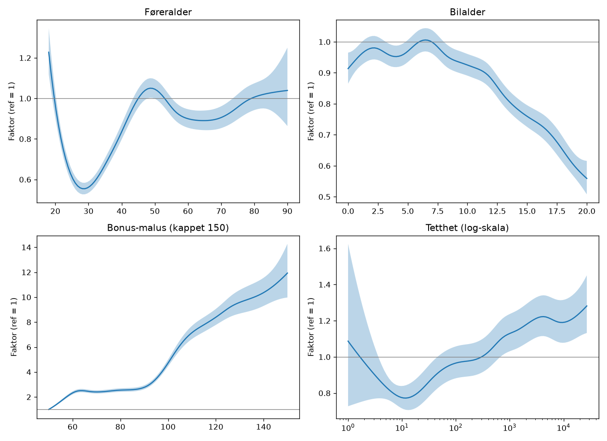
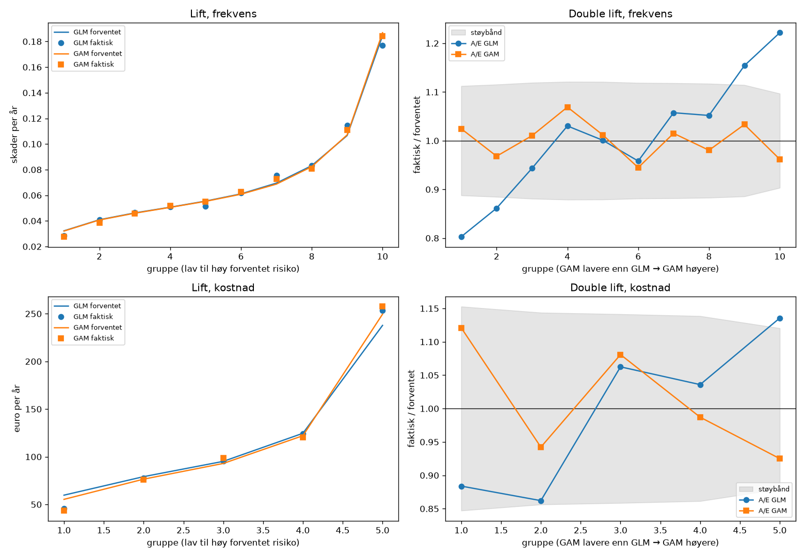
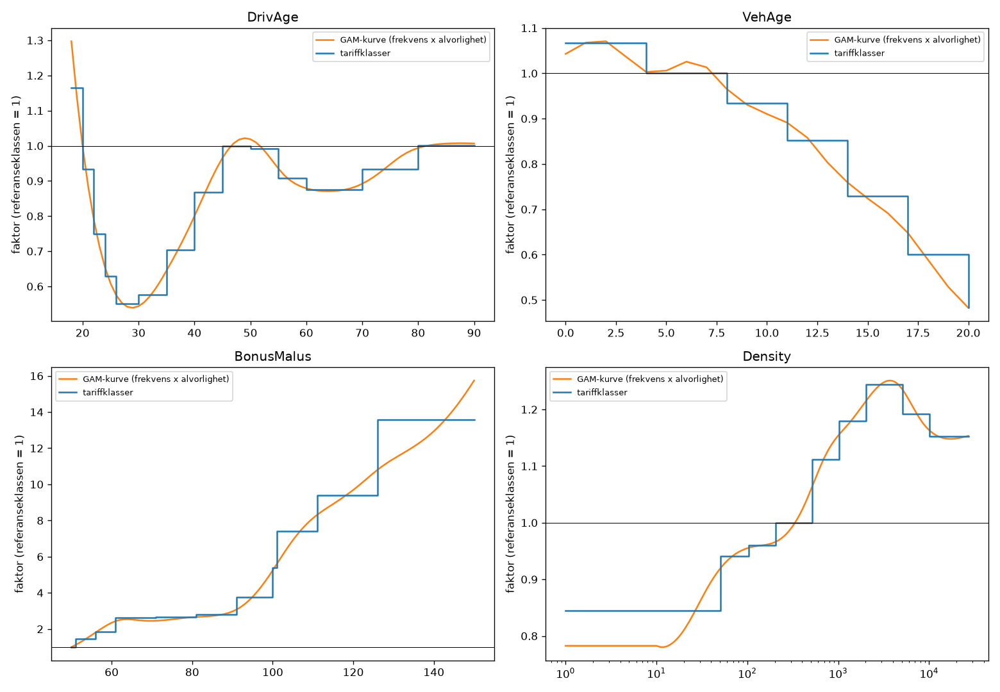
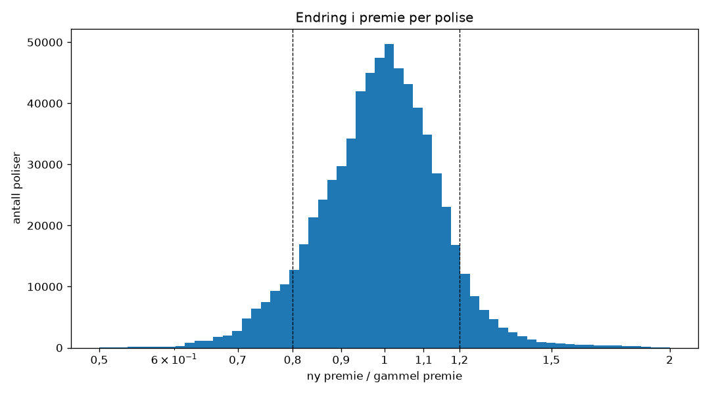

# Anbefaling om ny tariff for bilansvar

Dette er en læringsøvelse i prising av bilansvar, laget på det offentlige franske
datasettet freMTPL2 (OpenML id 41214 og 41215). «Dagens tariff» er en enkel
Poisson-GLM med grupperte variabler og lik skadestørrelse for alle, laget i
prosjektet som sammenligningsgrunnlag. Det er ikke en ekte tariff. Alle beløp er i euro.

## Anbefaling

Ta i bruk den nye tariffen. Den priser risikoen mer treffsikkert enn dagens, særlig
for kundene der de to tariffene er mest uenige. Prisøkninger over 20 % bør fases inn
over to til tre fornyelser, og reduksjoner bør begrenses tilsvarende.

## Hva som er gjort

- **Ny modell.** Skadefrekvens og skadestørrelse er modellert med glatte effektkurver
  (GAM). Dagens tariff bruker faste grupper og lik skadestørrelse for alle.
- **Fra kurver til tariff.** Kurvene er gjort om til en vanlig tariff med grunnpris og
  faktor per klasse. Grunnprisen dekker skadekostnaden, inkludert et påslag for storskader.
- **Testet på kunder modellen ikke har sett.** 20 % av de 678 013 polisene ble holdt
  utenfor og bare brukt til kontroll.

*Effektkurvene for skadefrekvens, som faktor relativt til referansekunden (45 år,
bil 7 år, bonus-malus 50, tetthet 300). Det skraverte feltet er et 95 %-intervall.*

## Hvorfor den nye tariffen er bedre

- **Dagens tariff bommer der prisen endres mest.** Kundene som får over 20 % lavere
  pris, hadde rundt 20 % lavere skadekostnad enn dagens tariff forventet. Kundene som
  får 10–20 % høyere pris, hadde rundt 20 % høyere.
- **Den skiller bedre mellom trygge og risikable kunder.** Forbedringen er liten, men
  stabil for skadefrekvens: modellen bak tariffen skilte bedre i 99 % av 200 nye trekk
  av testdataene.
- **Forenklingen til tariff kostet lite.** Tariffen beholder rundt 80 % av modellens
  forbedring, og halvparten av kundene får en pris innenfor 5 % av modellens.

*Til høyre: double lift. Polisene er sortert etter hvor mye GAM og GLM er uenige. Der
GAM priser høyere enn GLM (til høyre i hvert panel), har GLM for lav forventning.
GAM holder seg nær 1. Det grå feltet er et grovt 95 %-støybånd.*

*Samlet faktor (frekvens x skadestørrelse) fra GAM-kurvene og tariffklassene som
erstatter dem.*

## Hvem som merker endringen

Samlet premie er uendret, så endringen er ren omfordeling. 30 % av kundene får under
±5 % endring, og 15 % får mer enn ±20 %. Snittendringen er 23 € per år på en
snittpremie på 173 €.

| Kundegruppe | Endring i premie |
| --- | --- |
| Bonus-malus 91–99 og over 100 | +25 til +34 % |
| Førere 18–23 år | +11 til +13 % |
| Biler 0–3 år | +9 % |
| Førere 30–34 og 40–44 år | −9 til −11 % |
| Bonus-malus 51–55 | −15 % |
| Biler 17 år og eldre | −17 til −18 % |

De største enkeltøkningene, opptil 2,6 ganger dagens pris, gjelder 21-åringer med
malus og bil som er 0–3 år gammel.

*Ny premie delt på dagens premie, per polise. De stiplede linjene markerer ±20 %.*

## Risiko og tiltak

- **De største økningene er trolig for store.** De 7 % som får over 20 % økning,
  hadde 13 % færre skader og 18 % lavere skadekostnad enn den nye tariffen forventet.
  Avviket i antall skader er større enn støyen. Trolig overlapper ung alder og malus.
- **Tiltak: tak og innfasing.** Øk prisen med maks 20 % per fornyelse, slik at
  kundene når riktig pris over to til tre år. Begrens reduksjonene til 20 % på samme måte.
- **Taket berører 15 % av kundene.**
- **Nivået må justeres før bruk.** Tariffen er kalibrert på historiske skader. Den må
  justeres for forventet fremtidig skadenivå og inflasjon.

## Begrensninger

- Dataene er et offentlig fransk datasett for bilansvar (freMTPL2). Beløpene er i euro.
- Datasettet har ingen årstall. Testdataene er derfor et tilfeldig utvalg, ikke det
  siste året.
- «Dagens tariff» er en enkel modell laget i prosjektet, ikke en ekte tariff.
  Endringene blir derfor større enn ved en vanlig revisjon.
- 27 % av polisene med skademeldinger hadde ingen utbetaling og er regnet som
  skadefrie. Det må bekreftes med dataeier.
- Modellene er laget i Python (pyGAM), ikke i R (mgcv).

## Neste steg

1. Gi hver kurve sin egen glatthet. Da fanges trolig knekken i bonus-malus direkte, i
   stedet for at den rettes i tariffen etterpå.
2. Undersøke samspillet mellom ung alder og malus, som trolig gjør de største
   økningene for store.
3. Justere nivået til forventet fremtidig skadenivå før tariffen tas i bruk.

---

## Teknisk del

Koden ligger i `code/`, og skriptene 00 til 08 kjøres i rekkefølge. Tallene under
kommer fra en full kjøring.

### Data og testsplit

678 013 poliser og 26 639 skadebeløp. 195 skadebeløp uten tilhørende polise er fjernet.
Polisene er delt tilfeldig i trening (542 410 poliser, 286 721 eksponeringsår) og test
(135 603 poliser, 71 639 eksponeringsår) med fast seed. Testdataene er bare brukt til
kontroll. Eksponering over ett år (1 224 poliser) er satt til ett år.

### Skadedefinisjon

En skade telles bare når den har et beløp i skadefilen. 9 116 av de 34 060 polisene
med `ClaimNb > 0` (27 %) har ingen beløp. Med denne definisjonen bygger frekvens og
skadestørrelse på de samme skadene. Antallet er kappet på 4 per polise (8 poliser
hadde flere). Frekvensen i trening er 0,0738 skader per eksponeringsår, mot 0,1009
med rå `ClaimNb`.

### Storskader og påslag

Skadebeløp er kappet ved 99,5-persentilen av treningsskadene, 35 707 €. Det berører
106 skader. Delen av beløpene som ligger over terskelen, utgjør 26,8 % av den totale
skadekostnaden.
Overskuddet fordeles likt på alle som et påslag på 36,7 % av kappet kostnad.
Snittskaden i trening er 2 344 € rått og 1 715 € kappet.

### Frekvens: Poisson-GAM

Antall skader er modellert med Poisson-fordeling, log-link og eksponering som offset.
Føreralder (kappet ved 90), bilalder (kappet ved 20), bonus-malus (kappet ved 150) og
log tetthet er glatte kurver. Bilmerke, drivstoff og region er faktorer. Alle ledd
deler samme glatthetsparameter λ. Den er valgt med UBRE på et tilfeldig utvalg av
100 000 poliser over 11 verdier fra 1 000 til 0,01. Valgt λ = 100 (41,9 effektive
frihetsgrader).

### Skadestørrelse: Gamma-GAM

Kappet snittbeløp per polise med skade er modellert med Gamma-fordeling og log-link,
vektet med antall skader (19 998 poliser, 21 198 skader i trening). Samme variabler
som for frekvens. GCV er lavest ved λ ≈ 32, men kurvene blir da urolige. Valgt λ er
10 000 (16,6 effektive frihetsgrader), fordi kurvene da er plausible. Kurvene holdes
flate utenfor området med skadedata. Skalaparameteren er 1,94.

### Fra GAM til tariff

Faktoren for hver tariffklasse er snittet av GAM-kurven i klassen, vektet med
eksponering. For bonus-malus er frekvensfaktorene i tillegg justert mot klassens egne
data med kredibilitetsvekt (full vekt ved 1 082 forventede skader) og tvunget til å
være stigende. Grunnprisen er kalibrert på trening: 0,0556 skader per år x 1 660 €
= 92 € kappet, 126 € med storskadepåslag. Snittpremien i trening er 173 €. Hele
tariffen står i seksjonen «Tariffen i detalj» nederst i rapporten.

### Evaluering på test

Begge modellene er skalert til å treffe totalen på test før sammenligningen. Da måles
bare hvordan de fordeler risikoen.

| Mål | Dagens (GLM) | GAM | Ny tariff |
| --- | --- | --- | --- |
| Poisson-deviance, forbedring mot nullmodell | 4,71 % | 4,95 % | |
| A/E totalt, frekvens | 0,987 | 0,987 | 0,988 |
| A/E totalt, kappet kostnad | 0,940 | 0,941 | 0,939 |
| Gini, frekvens | 0,2969 | 0,3027 | 0,3017 |
| Gini, kappet kostnad | 0,3346 | 0,3381 | 0,3379 |
| Lift, faktisk frekvens høyeste/laveste tidel | 6,2x | 6,7x | |

- **A/E** er faktisk delt på forventet. Totalnivået på test ligger under 1 for kostnad
  for begge modellene, og det løses ved nivåjusteringen nevnt over.
- **Double lift** sorterer polisene etter forholdet GAM/GLM og sammenligner A/E i hver
  gruppe (se figuren over). Støybåndet for frekvens er 2·√(φ/forventede skader), med
  overdispersjon φ = 1,72 fra GLM. For kostnad brukes φ·(1 + 1,9), der 1,9 er
  skalaparameteren fra Gamma-GAM avrundet.
- **Gini med bootstrap:** 200 trekk med tilbakelegging fra testdataene. For frekvens er
  GAM bedre med +0,0058 (95 %-intervall +0,0014 til +0,0100, GAM best i 99 % av
  trekkene). For kostnad er forskjellen +0,0035 (95 %-intervall −0,0098 til +0,0125,
  GAM best i 74 % av trekkene) og ikke sikker.
- **Skadestørrelse alene:** Gamma-GAM forbedrer deviance med 0,45 % mot flat
  skadestørrelse på test. Mesteparten av gevinsten kommer fra frekvensmodellen.

## Tariffen i detalj

Tariffen består av en grunnpris og en faktor per klasse for sju variabler. Prisen for en kunde er grunnprisen ganget med faktoren fra hver tabell under. Variabler som ikke er nevnt, står på referanseklassen med faktor 1.

Grunnprisen er 126 € per år. Det er prisen for referansekunden, som er 45 år og har bil som er 4–7 år, bonus-malus 50, tetthet 201–500, bilmerke B1, bensin og region R24. Prisen er risikopremie, altså forventet skadekostnad inkludert storskadepåslaget. Påslag for kostnader og margin og justering for fremtidig skadenivå kommer i tillegg.

| Kunde | Utregning | Pris per år |
| --- | --- | --- |
| Referansekunden | Grunnprisen | 126 € |
| 19 år, bonus-malus 100, bil 0–3 år, tetthet 1 001–2 000 | 126 x 1,16 x 5,40 x 1,07 x 1,18 | 998 € |
| 30 år, bonus-malus 50, bil 15 år, tetthet 1–50 | 126 x 0,58 x 0,73 x 0,84 | 45 € |

Prisene er regnet med uavrundede faktorer, så utregningen med de avrundede tallene kan gi et litt annet resultat.

### Føreralder (år)

| Klasse | Faktor |
| --- | --- |
| 18–19 | 1,16 |
| 20–21 | 0,93 |
| 22–23 | 0,75 |
| 24–25 | 0,63 |
| 26–29 | 0,55 |
| 30–34 | 0,58 |
| 35–39 | 0,70 |
| 40–44 | 0,87 |
| 45–49 | 1,00 |
| 50–54 | 0,99 |
| 55–59 | 0,91 |
| 60–69 | 0,88 |
| 70–79 | 0,93 |
| 80 og over | 1,00 |

### Bonus-malus

| Klasse | Faktor |
| --- | --- |
| 50 | 1,00 |
| 51–55 | 1,45 |
| 56–60 | 1,85 |
| 61–70 | 2,61 |
| 71–80 | 2,66 |
| 81–90 | 2,81 |
| 91–99 | 3,77 |
| 100 | 5,40 |
| 101–110 | 7,43 |
| 111–125 | 9,41 |
| 126 og over | 13,59 |

### Bilalder (år)

| Klasse | Faktor |
| --- | --- |
| 0–3 | 1,07 |
| 4–7 | 1,00 |
| 8–10 | 0,93 |
| 11–13 | 0,85 |
| 14–16 | 0,73 |
| 17–19 | 0,60 |
| 20 og over | 0,48 |

### Tetthet (innbyggere per km²)

| Klasse | Faktor |
| --- | --- |
| 1–50 | 0,84 |
| 51–100 | 0,94 |
| 101–200 | 0,96 |
| 201–500 | 1,00 |
| 501–1 000 | 1,11 |
| 1 001–2 000 | 1,18 |
| 2 001–5 000 | 1,24 |
| 5 001–10 000 | 1,19 |
| 10 001 og over | 1,15 |

### Drivstoff

| Klasse | Faktor |
| --- | --- |
| Diesel | 1,15 |
| Bensin (Regular) | 1,00 |

Bilmerke (11 klasser)

| Klasse | Faktor |
| --- | --- |
| B1 | 1,00 |
| B2 | 0,99 |
| B3 | 1,07 |
| B4 | 1,02 |
| B5 | 1,09 |
| B6 | 1,00 |
| B10 | 1,11 |
| B11 | 1,29 |
| B12 | 0,82 |
| B13 | 1,09 |
| B14 | 0,91 |

Region (22 klasser)

| Klasse | Faktor |
| --- | --- |
| R11 | 0,96 |
| R21 | 1,02 |
| R22 | 1,05 |
| R23 | 0,98 |
| R24 | 1,00 |
| R25 | 0,97 |
| R26 | 0,99 |
| R31 | 1,02 |
| R41 | 0,92 |
| R42 | 1,00 |
| R43 | 1,03 |
| R52 | 1,00 |
| R53 | 1,00 |
| R54 | 1,06 |
| R72 | 1,07 |
| R73 | 0,84 |
| R74 | 1,15 |
| R82 | 1,19 |
| R83 | 0,96 |
| R91 | 1,02 |
| R93 | 1,13 |
| R94 | 1,06 |

Faktorene delt i frekvens og skadestørrelse ligger i `results/tariff_faktorer.csv`, og grunnprisen i `results/tariff_grunnpris.json`.
